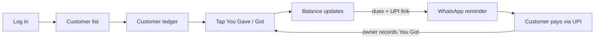

# Hisaab MVP PRD: Digital Khata Web App

Nov 1, 2026 · @Sourav

**Links:** [PRD doc](https://claude.ai/artifact/CrQLNF4nnB1TCSCNyndBfA) · [Design canvas: landing page + app screens](https://claude.ai/artifact/PQsEWeCrztD8YxTgth1gTd)

## Overview

We will ship a fast, ad-free digital khata (credit ledger) as a mobile-friendly web app (PWA) in 2 weeks, tested by 2–3 real small-business users.

**Working name:** Hisaab (placeholder; final name open).

**Problem.** Small shopkeepers and service businesses in India give goods or services on credit (udhaar) every day. They track it in paper notebooks, lose track of who owes what, and find chasing payments awkward. Existing apps solve this, but many users stop entering data because it feels slower than pen and paper, and the leading apps have grown into platforms with loans, ads and upsells.

**Solution.** A focused ledger: add a customer, record "You Gave" or "You Got" in about 3 taps, see the running balance, and send a WhatsApp reminder with a UPI payment link. It opens from a link on any phone, with nothing to install.

**Vision.** Recording a credit entry should be faster than writing it in a notebook.

## MVP definition

Version 1 is one loop done well: a shop owner can add customers, record credit and payments, see correct balances, and send a WhatsApp reminder with a UPI link, from a link on their phone.

| In v1 (must ship) | Out of v1 (future scope) |
| --- | --- |
| Sign up / log in (email + password) | Phone OTP login |
| Customers: add, edit, delete, search, sort | Importing from phone contacts |
| You Gave / You Got entries with note and date | Inventory, billing, GST invoices |
| Customer ledger with running balance | Loans, ads, multi-store |
| Totals: you'll get / you'll give | Automated SMS, scheduled reminders |
| WhatsApp reminder with UPI link | Payment gateway with auto-reconciliation |
| PDF statement per customer | Full offline sync |
| Mobile-first PWA (Add to Home Screen) | Native Android/iOS apps |
| One standout: quick text entry ("sharma 420 atta") | Voice entry, more languages |

**Release criteria (definition of done)**

- [ ] Every P0 feature (F1–F8) passes its acceptance criteria
- [ ] Running balances match manual calculation for a 50-entry test ledger
- [ ] Works on Android Chrome and iPhone Safari at 360 px width
- [ ] Saving an entry takes 3 taps or fewer from the customer ledger
- [ ] Users can only see their own data (row-level security tested with 2 accounts)
- [ ] Deployed at a public link with no console errors
- [ ] At least 2 real users have recorded entries for 5 days

## Goals, non-goals and success metrics

Success means a small group of real users keep using the app for a full week, not feature parity with Khatabook.

**Goals**

1. Deliver a working, deployed ledger app (live link) within 14 days.
2. Make entry recording faster than a paper notebook (about 3 taps).
3. Help users collect dues through WhatsApp reminders with a UPI link.
4. Never lose data and never show a wrong balance.

**Non-goals (MVP)**

- GST invoicing, inventory, billing, loans or multi-store support
- Native Android/iOS apps or a Play Store release
- Automated SMS sending or a payment gateway with automatic reconciliation
- Full offline sync and regional languages beyond Hindi/English

**Success metrics**

| Metric | Target |
| --- | --- |
| Real users testing in week 2 | 2–3 |
| Users still entering data after 5 days | At least 2 |
| Median time to record an entry | Under 10 seconds |
| Balance calculation errors found in testing | 0 |
| Core flow working end to end | By Day 5 |

## Target users and personas

The primary user is a small business owner who gives credit to repeat customers and records it alone, on a low-cost Android phone.

| Persona | Context | Main need | Pain today |
| --- | --- | --- | --- |
| Ramesh, kirana shop owner (45) | 40–60 regular families buy on credit; busy counter | Record entries in seconds; know total pending | Notebook errors, awkward to ask for money |
| Priya, tuition teacher (28) | 25 students paying monthly fees | See who hasn't paid this month; send polite reminders | Forgets who paid; chasing parents |
| Suresh, milk supplier (38) | Daily deliveries, monthly settlement | Running monthly total per household | Disputes over amounts at month-end |
| Customer of the shop | Receives messages, no app | Clear statement of what they owe; easy way to pay | Doesn't trust the shopkeeper's notebook |

**Niche decision (open).** A general khata competes head-on with free apps. Pick one focus before Day 3 so the copy, labels and demo data fit it:

- Kirana or general store (closest to Khatabook)
- Tuition teachers (monthly fee tracking)
- Milk or newspaper delivery (daily entries, monthly settlement)
- PG/hostel owners or mess (monthly rent or meal dues)

The data model stays the same for all four; only labels and defaults change.

## Competitive landscape and positioning

The credit-ledger market is led by free, well-funded apps, so we compete on focus and speed, not features. User numbers below are each company's own claims.

| Product | Type | Price | What it offers |
| --- | --- | --- | --- |
| [OkCredit](https://okcredit.in/en/) | Credit ledger (closest rival) | Free | Customer balances, SMS-confirmed entries, auto reminders, UPI collection; claims 1 crore+ shopkeepers, 11 languages |
| [Khatabook](https://www.g2.com/products/khatabook/discuss) | Credit ledger + platform | Free (freemium) | Ledger, inventory, payments, loans; 50M+ downloads, 13 languages |
| [CashBook](https://apps.apple.com/us/app/id1632006509?l=en-us) | Cash in/out book | Free | Cash-in-hand, multiple books, staff UPI wallets; 1M+ users |
| [Vyapar](https://www.getapp.com/finance-accounting-software/a/vyapar/) | Billing + GST accounting | From ₹3,399/yr (desktop) | Invoices, inventory, GST, reports |
| [myBillBook](https://www.taxaj.com/learn/best-gst-billing-software-indian-retailers-2026/) | Billing + GST | ₹3,490–3,990/yr (Diamond/Platinum) | GST billing, multi-user, cloud sync |
| Digi Khata, Udhaar Book, others | Credit ledger clones | Free | Feature copies of the leaders |

**Gaps we target**

- **Simplicity.** OkCredit's own switching page lists ads, paywalled features and apps that "grew into a platform" as reasons people change khata apps.
- **Niche fit.** No leader is built around tuition fees, milk delivery or PG rent.
- **Zero install.** All leaders are mobile-app first; a PWA opens instantly from a shared link.
- **Adoption.** Users drop off when entry is slower than a notebook, so speed is the core feature.

**Positioning statement.** For [chosen niche] who track credit in notebooks, Hisaab is a fast, ad-free khata that works from a link. Unlike Khatabook and OkCredit, it does one job, recording and collecting dues, with nothing to install.

## Feature requirements

The MVP ships every P0 feature, two or three P1 features, and exactly one P2 standout feature. If time runs short, cut from P1/P2, never from P0.

### P0: must have (Week 1)

| ID | Feature | Requirement | Acceptance criteria |
| --- | --- | --- | --- |
| F1 | Sign up / log in | Email + password or phone OTP; each user sees only their own data | New user can sign up and reach an empty dashboard in under 1 minute; data isolated per user |
| F2 | Customer list | Add, edit, delete, search customers (name, phone, optional note) | Each row shows net balance in red (you'll get) or green (you'll give); search filters as you type; sort by amount or oldest due |
| F3 | Record entry | "You Gave ₹" and "You Got ₹" buttons; amount, optional note, date (defaults to today) | Entry saved in 3 taps or fewer; balance updates instantly |
| F4 | Customer ledger | Timeline of entries with running balance after each | Running balance matches a manual calculation for 50+ entries |
| F5 | Edit / delete entry | Correct mistakes; confirm before delete | Balance recalculates after edit or delete |
| F6 | Totals header | Total receivable and total payable across all customers | Totals equal the sum of customer balances |
| F7 | WhatsApp reminder | One tap opens WhatsApp (`wa.me`) with a pre-filled message: name, amount due, shop name | Works on Android Chrome and iPhone Safari |
| F8 | Cloud storage | All data stored in the cloud database | Logging in on another device shows the same data |

### P1: should have (Week 2, pick 2–3)

| ID | Feature | Requirement | Acceptance criteria |
| --- | --- | --- | --- |
| F9 | UPI link in reminder | Add a `upi://pay?pa=<vpa>&am=<amount>` link using the owner's UPI ID | Tapping the link opens GPay/PhonePe with amount filled (Android) |
| F10 | PDF statement | Per-customer statement for a date range, shareable | PDF shows opening balance, entries, closing balance |
| F11 | Dashboard | Collected this week, top 5 overdue customers | Numbers match the ledger |
| F12 | Due dates + bulk reminder | Optional collect-by date; send reminders to all customers with dues | Overdue customers are flagged |
| F13 | Supplier ledger | Same flow in a separate Suppliers tab | Supplier and customer totals kept separate |
| F14 | PWA install | Manifest + service worker; Add to Home Screen | App opens full-screen with an icon |
| F15 | Onboarding | 3-step first-run guide + sample customer | A new user records a first entry without help |
| F16 | Hindi / English toggle | UI strings in both languages | All screens switch language |

### P2: one standout feature (Day 11)

| ID | Feature | Description |
| --- | --- | --- |
| F17 | Quick text entry (recommended) | Typing "Ramesh 500 gave" creates the entry; matches the customer by name |
| F18 | Credit risk tags | Customers tagged reliable, slow or risky from payment history |
| F19 | Daily cashbook | Track the day's cash in and cash out |
| F20 | Staff access + audit log | Helpers can add but not delete; all changes logged |

## Key user flows and screens

The whole product is one loop: record credit, remind the customer, record the payment. Every screen exists to make that loop faster.

Recording an entry should take 3 taps from the customer ledger; the payment closes the loop as a "You Got" entry.

**Screens**

| Screen | What it shows | Key actions |
| --- | --- | --- |
| Login / sign up | Business name, phone or email | Sign up, log in |
| Home (customer list) | Total receivable/payable; customers with balances | Search, sort, add customer, switch to Suppliers |
| Add / edit customer | Name, phone, note, due date | Save, delete |
| Customer ledger | Balance, entry timeline with running balance | You Gave, You Got, Remind, Statement PDF |
| Entry form | Amount (numeric keypad), note, date | Save in one tap |
| Dashboard | Collected this week, top overdue | Bulk reminder |
| Settings | Business name, UPI ID, language | Edit profile, log out |

## UI and visual design (Option 2)

The app and landing page share the Option 2 look: off-white and near-black with one acid-lime accent, a Geist sans mixed with Instrument Serif italics, pill-shaped controls and monospace amounts. Mockups: [Hisaab design canvas](https://claude.ai/artifact/PQsEWeCrztD8YxTgth1gTd) (landing page + 4 app screens).

**Design tokens**

| Token | Value | Use |
| --- | --- | --- |
| Background | #F6F6F3 | App and page ground |
| Surface | #FFFFFF, border #E4E4DF | Cards, inputs, list rows |
| Ink | #0E0E0E | Text, primary buttons, dark cards |
| Muted text | #5C5C57 | Labels, secondary lines |
| Accent (lime) | #D4FF3A | Save, Remind, highlights; always with dark text |
| You'll get (due) | #C43A12 | Amounts the customer owes, always labelled in words |
| You'll give / got | #127A4B | Payments and amounts the shop owes |
| Radius | 999px pills; 16–28px cards | Buttons, chips; cards and sheets |
| Spacing | 4px base; 8 / 12 / 16 / 20 / 24 | Gaps and padding |

**Typography**

| Role | Font | Size / weight |
| --- | --- | --- |
| Headings | Geist | 20–34px, 600, tight tracking (−0.03em) |
| Emphasis words | Instrument Serif italic | Same size as heading, 400 |
| Body and labels | Geist | 13–16px, 400–500 |
| Amounts | Geist Mono | 15px in lists, 40–64px for balances |

All three are free on Google Fonts.

**Core components**

- Pill button: primary (ink), accent (lime), secondary (white with border); minimum 44px tall, 56px for main actions
- Balance card: label in words + large mono amount + "since" date
- Customer row: avatar initials, name, status line, amount with "you'll get / you'll give" under it
- Entry card: item, date and running balance, amount in Gave or Got column
- Quick-entry bar: monospace input + round add button, pinned to the bottom of Home
- Bottom sheet: dark header, rounded light sheet (used for the reminder)
- Numeric keypad: 3×4 grid of 56px keys, 00 and delete

**MVP screens**

| Screen | Key elements | Primary action |
| --- | --- | --- |
| Home (customers) | Totals card, Remind-all button, search, Customers/Suppliers tabs, customer list, quick-entry bar | Open a customer or type a quick entry |
| Customer ledger | Balance card, Remind and Statement buttons, entry cards with running balance | You gave ₹ / You got ₹ |
| Add entry | Gave/Got toggle, big amount, live new balance, note, date chip, keypad | Save entry |
| WhatsApp reminder | Message preview, UPI link toggle, UPI ID, tone chips (Polite, Festival, Hindi) | Send on WhatsApp |
| Login, Add customer, Settings | Same components; not yet drawn | Build from the components above |

**UI rules**

- Never show a balance colour without its words ("you'll get" / "you'll give"), for accessibility.
- Text contrast at least 4.5:1; lime is only ever a background behind dark text.
- No emoji, gradients or stock illustrations; product UI is the visual.

## Data model

Three core tables cover the MVP; balances are calculated from transactions, never stored by hand, so they can't drift.

| Table | Key fields | Notes |
| --- | --- | --- |
| users | id, name, business_name, phone, upi_id, language, created_at | One row per shop owner (managed by Supabase/Firebase auth) |
| parties | id, user_id, name, phone, type (customer / supplier), note, due_date, created_at, deleted_at | Customers and suppliers share one table; soft delete |
| transactions | id, party_id, user_id, type (gave / got), amount (integer paise), note, txn_date, created_at, updated_at | Amount stored in paise to avoid rounding errors |

**Rules**

- Balance of a party = sum(gave) − sum(got). Positive = customer owes the shop.
- Every query filters by `user_id`; enforce this with database row-level security.
- Amounts must be greater than 0 and at most ₹10,00,000 per entry.
- Deleting a party soft-deletes it and hides its transactions from totals.

## Non-functional requirements

The app must feel fast and trustworthy on a low-cost Android phone with a patchy 4G connection.

| Area | Requirement |
| --- | --- |
| Performance | First load under 3 seconds on 4G; saving an entry under 1 second |
| Devices | Works on Android Chrome and iPhone Safari, screens from 360 px wide; desktop as a bonus |
| Usability | Tap targets at least 44 px; amounts in large type; numeric keypad for amounts; ₹ formatting in Indian style (1,00,000) |
| Reliability | No data loss; balances always correct; daily database backup (built into Supabase/Firebase) |
| Security | HTTPS only; row-level security so users see only their data; no secrets in frontend code |
| Privacy | Collect only names, phone numbers and amounts; no ads or third-party trackers; simple privacy note |
| Accessibility | Readable contrast; red/green balances also labelled in words ("You'll get" / "You'll give") |
| Connectivity | Show a clear error and keep the form filled if a save fails offline (full offline sync is future scope) |

## Tech stack and architecture

A React PWA talks directly to a hosted backend (Supabase), so there is no custom server to build or maintain in 2 weeks.

| Layer | Choice | Why |
| --- | --- | --- |
| Frontend | React + Vite (or Next.js), TypeScript optional | Fast to build, widely documented |
| Styling | Tailwind CSS | Quick mobile-first layouts |
| Backend + DB | Supabase (Postgres, auth, row-level security) or Firebase | Login, database and backups with no server code; free tier fits |
| PDF | jsPDF or react-pdf | Client-side statement generation |
| PWA | vite-plugin-pwa | Manifest, icon, service worker |
| Hosting | Vercel or Netlify | Free, deploys on every git push |
| Messaging | `wa.me` links + `upi://pay` links | No paid API needed |

**How it fits together:** the browser app handles all screens and calculations, Supabase stores users, parties and transactions with row-level security, and reminders hand off to WhatsApp and UPI apps already on the phone.

**If the mentor requires a different stack:** the same data model works with a Node/Express + MongoDB backend or a Flutter frontend; expect 2–3 extra days for a custom backend.

## Timeline and milestones

The core ledger (P0) must work end to end by Day 5; Week 2 turns it into a product and puts it in front of real users.

| Day(s) | Work | Milestone |
| --- | --- | --- |
| 1 | Scope, schema, project setup | |
| 2 | Login and app layout | |
| 3 | Customer list | First deploy live |
| 4–5 | Entries, ledger, totals | **Core ledger done (Day 5)** |
| 6–7 | WhatsApp + UPI reminder | Mentor review (Day 7) |
| 8 | PDF statement | |
| 9 | Dashboard | |
| 9–13 | Real-user testing and fixes | |
| 10 | Supplier ledger / due dates | |
| 11 | Standout: quick entry | |
| 12 | PWA + onboarding polish | |
| 14 | README, demo video, rehearsal | Demo day |

Deploy on Day 3 so there is always a live link, show the mentor on Day 7, and run real-user testing from Day 9.

**If behind schedule, cut in this order:** supplier ledger → dashboard → standout feature → PDF statement. Never cut P0 features or testing.

**Demo-day deliverables (Day 14)**

- [ ] Live link (Vercel/Netlify)
- [ ] GitHub repo with README and screenshots
- [ ] 2-minute demo video of the core loop
- [ ] 5-slide presentation: problem, competitors, solution, demo, real-user feedback, future scope

## Risks, open questions and future scope

The biggest risk is scope creep; the second is users dropping off because entry feels slow.

| Risk | Impact | Mitigation |
| --- | --- | --- |
| Scope creep | Core unfinished by demo | Freeze P0 on Day 1; cut P1/P2 first |
| Users stop entering data | App loses value | 3-tap entry, quick text entry, test with real users in week 2 |
| Wrong balances | Loss of trust | Calculate from transactions, store paise, test against manual sums |
| Mentor wants another stack | Rework | Confirm stack on Day 1 |
| No test users found | Weak validation | Line up 2–3 shops, teachers or relatives by Day 7 |
| UPI links behave differently on iPhone | Reminder less useful on iOS | Show UPI ID as text alongside the link |

**Open questions**

- [ ] Which niche do we focus on (kirana, tuition, milk delivery, PG/mess)?
- [ ] Final product name?
- [ ] Does the mentor require a specific stack or a custom backend?
- [ ] Who are the 2–3 real test users?
- [ ] Email or phone OTP login? (OTP costs money beyond free tiers)

**Future scope (mention in presentation, don't build now)**

- Full offline mode with background sync
- Automated SMS and scheduled reminders (MSG91/Twilio)
- Payment gateway with automatic reconciliation
- More regional languages and voice entry
- Android app via Capacitor; Play Store release
- Customer-facing view link so customers can see their own statement

## Sources

- [OkCredit home](https://okcredit.in/en/) and [Khatabook alternative page](https://okcredit.in/khatabook-alternative)
- [G2 – Khatabook](https://www.g2.com/products/khatabook/discuss)
- [CashBook – App Store](https://apps.apple.com/us/app/id1632006509?l=en-us)
- [GetApp – Vyapar pricing](https://www.getapp.com/finance-accounting-software/a/vyapar/)
- [Taxaj – GST billing software 2026](https://www.taxaj.com/learn/best-gst-billing-software-indian-retailers-2026/)
- [DEV Community – Why shopkeepers still prefer notebooks](https://dev.to/yourmdsarfaraj/building-rupaya-khata-a-simple-credit-ledger-for-small-shopkeepers-20da)
- [SpotSaaS – Khatabook reviews](https://spotsaas.com/product/khatabook/reviews)
